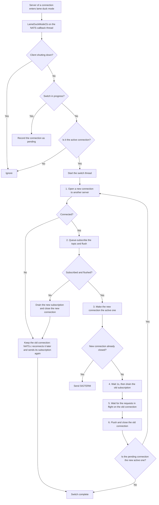

# NATS Lame Duck Mode Handling

## Overview

A NATS server enters lame duck mode before it shuts down, for example during a rolling restart of the NATS cluster. In lame duck mode the server:

1. Stops accepting new client connections.
2. Sends an `INFO` message with `ldm: true` to its clients.
3. Waits for `lame_duck_grace_period` (10s on the Wildlife stag cluster).
4. Closes its client connections, spread over the rest of `lame_duck_duration` (30s on the Wildlife stag cluster).

The existing connections work normally until the server closes them. The client uses that time to move to another server without losing messages.

## Connection swap

`NatsClientImpl` holds one active connection. When the server of the active connection enters lame duck mode, NATS.c calls `LameDuckModeCb`. The callback only starts a switch thread, because NATS.c runs the callbacks of all connections on one thread.

The switch thread does these steps:

1. **Open a new connection.** The server in lame duck mode does not accept it, so the new connection goes to another server. This connection does not retry its first connect, so that a switch does not block while NATS is unreachable.
2. **Subscribe the new connection** to the server topic, and flush, so that the server confirms the subscription.
3. **Make the new connection the active one.** New requests and publishes use it.
4. **Wait 1s, then drain the old subscription.** The wait lets the new subscription reach all servers of the cluster. The drain sends `UNSUB` and then delivers the messages that the client already received.
5. **Wait for the requests in flight** on the old connection, so that their replies are not lost. The wait is limited to `max(drainTimeout, requestTimeout)`.
6. **Flush and close the old connection.**

The server topic uses a queue subscription, with the topic as the queue name. Thus the old and the new subscription can exist at the same time, and NATS delivers each message to only one of them.

If step 1 or step 2 fails, the client keeps the old connection. When the server closes it, NATS.c reconnects it to another server and sends its subscription again. In that case, messages that are sent to the server topic during the reconnection can be lost.

If the server of the new connection enters lame duck mode during a switch, the client switches again when the current switch is complete.

### Flow

## Failure handling

- If the active connection closes because all reconnection attempts failed, the client sends `SIGTERM` to the process. The process stops instead of continuing without a connection. A replaced connection that the client closes on purpose does not send `SIGTERM`.
- `Subscribe` returns `NATS_ILLEGAL_STATE` while a switch is in progress. `IsInLameDuckMode()` returns `true` during a switch.

## Shutdown

- `NatsRpcServer::Shutdown()` stops accepting RPCs. Messages that arrive after that get a "server is shutting down" error.
- The `NatsClientImpl` destructor waits for a switch in progress, drains the active subscription, closes the active connection, and waits until the closed callback of each connection has run.
- A completed drain is the only guarantee that no message callback is still running. If a drain times out, a callback can still run after the destructor returns.

## Configuration

| Parameter | Default | Use |
|---|---|---|
| `drainTimeout` | 1000 ms | Time limit for each subscription drain |
| `flushTimeout` | 1000 ms | Time limit for each flush |
| `requestTimeout` | 2000 ms | Also limits the wait for requests in flight on the old connection |
| `connectionTimeout` | 2000 ms | Time limit to open the new connection |

A switch takes about 5 to 6s in the worst case. Make sure that the `lame_duck_grace_period` of the NATS cluster is longer than that.

## Limits

- NATS core delivers each message at most once. The connection swap removes the loss windows in this client. A client that sends a request to this server, and that is itself connected to the server in lame duck mode, depends on its own lame duck handling.
- During the switch, message callbacks can run on two subscription threads at the same time.
- No automated test triggers lame duck mode. To test the switch, do a rolling restart of a NATS cluster while a server that uses this library is running.
